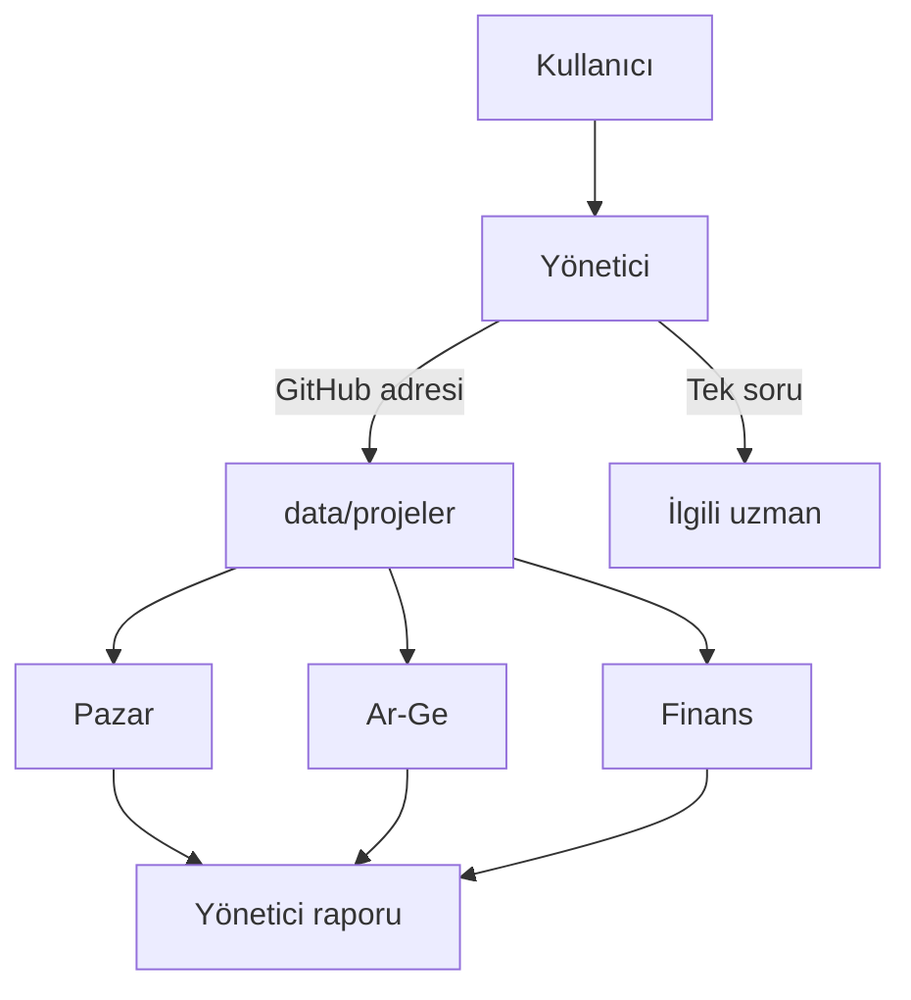

# BCD TECHNOLOGIES Çoklu Ajan

Yönetici ajan gelen isteği üç uzmana ayırır: Operasyon ve Pazar Geliştirme, Muhasebe ve Finans, Teknik ve Ar-Ge. Bir GitHub adresi verildiğinde depo önce okunur; üç uzman aynı kayıt üzerinden tek yönetici raporunda birleşir.



Finans tutarları `data/finans/giderler.json` dosyasındadır. Proje özetleri `data/projeler/` altına yazılır. Gizli depolar `.env` içindeki `GITHUB_TOKEN` ile okunur.

## Klasör yapısı

```text
agents/     supervisor, market, finance, rnd, brief
tools/      GitHub okuma, finans defteri, pazar ve Ar-Ge metni
data/       giderler.json ve kaydedilen depo özetleri
memory/     süreç içi oturum belleği
api/        FastAPI uygulaması
main.py     terminal sohbeti ve sunucu
```

## Kurulum

Python 3.10 veya daha yeni bir sürüm gerekir.

```bash
python -m venv .venv
.venv\Scripts\activate
pip install -r requirements.txt
copy .env.example .env
```

LLM için `LLM_PROVIDER` değerini `gemini` yapın ve `GEMINI_API_KEY` doldurun. Model `gemini-3.8-flash` olarak ayarlıdır. İstekler dakikada `LLM_RPM` (varsayılan 4) ile sınırlanır, geçici hatalarda dört kez yeniden denenir. Ana model yine de hata verirse aynı sıcaklıkla `gemini-3.5-flash-lite` yedeği devreye girer; yedek model kendi `LLM_FALLBACK_RPM` tavanını kullanır. `GEMINI_API_KEYS` birden fazla anahtar içerirse anahtarlar sırayla kullanılır. `ADMIN_USERNAME` ve `ADMIN_PASSWORD` birlikte doluysa komuta merkezi HTTP Basic Auth ister.

## Çalıştırma

```bash
python main.py demo
python main.py ask "https://github.com/bariscandasci/ankaras"
python main.py chat
python main.py serve
```

Servis `http://127.0.0.1:8000` adresinde komuta merkezini açar. Sohbet, proje ve gider uçları `/api` altındadır. Yerel sertifika verilirse aynı komut HTTPS dinler:

```bash
python main.py serve --ssl-keyfile key.pem --ssl-certfile cert.pem
```

## Test

```bash
pytest
```

Testler GitHub'a ve modele çıkmaz. Finans hesabı geçici bir defter kopyasıyla yapılır.
