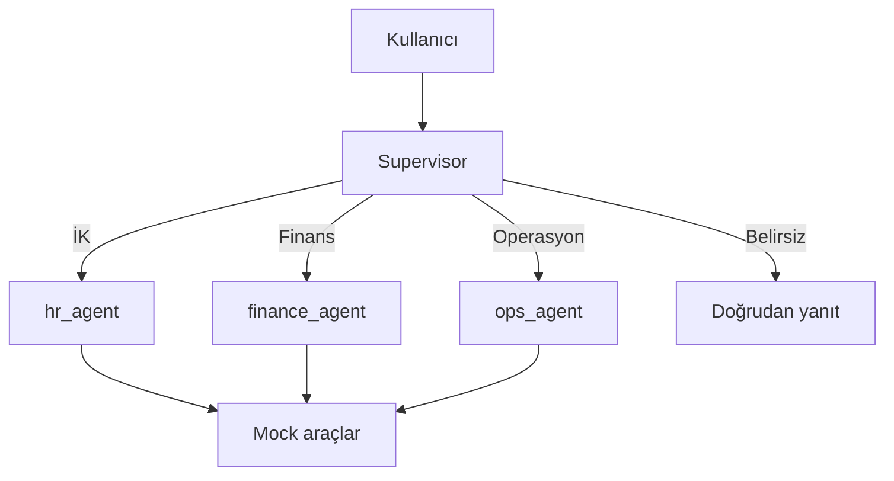

# Şirket İçi Çoklu Ajan Sistemi

Yönetici ajan gelen isteği üç departmandan birine yönlendirir: İK, finans ve operasyon. Her departmanın örnek veriyle çalışan mock araçları vardır. API anahtarı yokken sistem bu araçlarla yanıt verir; anahtar tanımlanınca aynı grafik LangGraph üzerinden OpenAI veya Gemini ile konuşur.



## Klasör yapısı

```text
agents/     supervisor.py, hr_agent.py, finance_agent.py, ops_agent.py
tools/      departman başına mock araçlar
memory/     süreç içi oturum belleği
api/        FastAPI uygulaması
main.py     terminal sohbeti ve sunucu
.env.example
requirements.txt
```

## Kurulum

Python 3.10 veya daha yeni bir sürüm gerekir.

```bash
python3 -m venv .venv
source .venv/bin/activate
pip install -r requirements.txt
cp .env.example .env
```

`.env` içindeki anahtarlar boş kalabilir. Bu durumda ajanlar mock modda çalışır.

LLM kullanmak için `LLM_PROVIDER` değerini `openai` veya `gemini` yapın ve ilgili anahtarı doldurun. `OPENAI_BASE_URL` OpenAI uyumlu başka bir ucu da kabul eder. Model adını hesabınızın erişebildiği bir modelle değiştirin.

## Çalıştırma

Üç örnek isteği tek seferde görmek için:

```bash
python main.py demo
```

Tek soru:

```bash
python main.py ask "Ayşe Demir hangi departmanda?"
```

Terminal sohbeti (`/exit` çıkar, `/reset` oturumu sıfırlar):

```bash
python main.py chat
```

API:

```bash
python main.py serve
```

Servis `http://127.0.0.1:8000` adresinde açılır. Açık API şeması `/docs` altındadır.

```bash
curl -s http://127.0.0.1:8000/chat \
  -H 'content-type: application/json' \
  -d '{"message":"Son çeyrek gelir gider özeti","session_id":"demo"}'
```

`session_id` aynı kaldıkça takip cümleleri aynı departmanda kalır. Bellek sürecin içindedir; sunucu kapanınca silinir.

## Test

```bash
pytest
```

Testler ağa çıkmaz. Yanıtlar `Kuzey Yazılım A.Ş.` adlı uydurma şirket verisinden gelir.

## Bu aşamada olmayanlar

API'de kimlik doğrulama yoktur; servisi yalnız yerel denemede kullanın. Personel, fatura ve sunucu kayıtları canlı sistemlerden okunmaz. Sonraki aşamada mock araçların arkasına gerçek veri kaynakları bağlanabilir.
